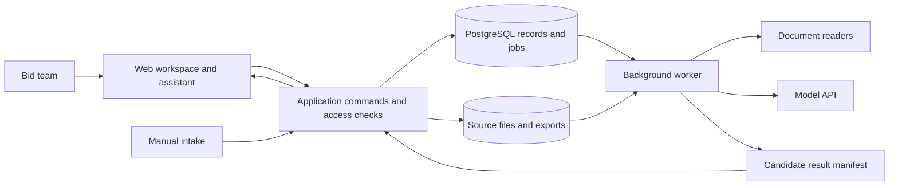

# Architecture

The application uses Next.js, FastAPI, PgQueuer and Supabase PostgreSQL/Storage/Auth. Existing assessments, source readers and the assistant remain supported. Screening and preparation are implemented behind `QUALIFICATION_WORKFLOW_ENABLED`, which defaults to false. Controlled checks and one reviewed case do not establish independent usefulness or pilot readiness; see the reliability follow-up (local only). Broader lifecycle capabilities below remain proposals.

## Design intent

Build one application with clear internal modules and a background worker. Users and the assistant operate on the same records through the same authorised commands. Five capabilities do not require five autonomous agents or separate services.

The durable product is the current tender record, its source evidence, working artifacts and review history. Chat is an interaction surface. The model is an analysis and drafting component. Approval validity is an application rule.

## System shape

The diagram describes responsibilities, not a microservice estate. Keep the frontend, application API and worker in one repository. Next.js serves the frontend in development and production on port 3000; the application requires its Next server rather than a Vite static-asset deployment. Its same-origin `/api/:path*` rewrite targets FastAPI on port 8765 by default. Vite is used only by the browser test runner. Use database-backed jobs initially; add separate queue infrastructure only when measured throughput or reliability requires it.

## Technology

The application uses Next.js App Router, React and TypeScript; FastAPI and Pydantic; Supabase PostgreSQL, Storage and Auth; and PgQueuer-backed Python workers. Docling and native readers process supported documents, and PDF.js displays sources. The Next server proxies same-origin API requests to FastAPI; Vite is used for browser tests. The server owns authentication, authorised commands, jobs, model requests and secret keys.

## Current frontend composition

| Path | Responsibility |
|---|---|
| `apps/web/src/app/layout.tsx` | Shared fonts, persistent theme provider and toast host. |
| `apps/web/src/circle/` | Retained desktop frame/sidebar, UI primitives, split panes and standard theme tokens. |
| `apps/web/src/app/(workspace)/` | Protected Tenders, Inbox, Reviews, Members, Company profile, a single Settings page for Appearance and Profile. |
| `apps/web/src/features/qualification/` | Existing business controls plus real-data workspace views. |
| `apps/web/src/app/sign-in/` | Supabase sign-in and restricted post-login destinations. |
| `apps/web/next.config.ts` | Root-to-Tenders and compatibility redirects, shared public environment values and API proxy. |

The root opens `/tenders`. Legacy Inbox and Reviews derive actions from authorised tender reads. With screening enabled, the bounded inbox-actions and review-cases endpoints supply Human/Agent Inbox and team assessment progress. Members uses the workspace directory. There is no fake organization/team switcher or canned global agent. The existing bounded assistant remains inside tender detail.

The board displays backend assessment status without mutating decisions. AI recommendations, source currency and human decisions remain distinct. A paginated workspace-task endpoint is deferred until data volume warrants it. Appearance has persistent Light/Dark tabs; Profile shows the account image, email, name and role read-only.

Source and licence information is recorded in [THIRD_PARTY.md](apps/web/licenses/README.md) and [the adaptation record](apps/web/licenses/README.md).

## Domain records

Tenders, source versions, accepted company evidence, assessments, screening artifacts, review tasks, decisions and jobs are workspace-scoped. Sources and accepted outputs retain their immutable versions and input manifests. Review and decision history is not rewritten when later inputs change. Chat is separate from authoritative evidence or approval records.

## Source processing and retrieval

1. Validate a supported upload and preserve the original bytes and hash. Record every file before parsing begins.
2. Parse to text/tables plus source locations. Store a manifest with complete/partial/failed status and the reason. Scanned or unreadable sections require visible review.
3. Produce candidate fields and requirements with source anchors. Verify cited locations exist; important dates and mandatory requirements need an explicit review checklist.
4. Show candidates for correction/acceptance. Preserve reviewer edits, the originating evidence and superseded versions.
5. Retrieve only records the user/job can access. Prefer the current tender source set and current approved company evidence. If sources disagree or are outdated, expose that conflict.

A requirement may cite an older original clause that remains effective alongside a later amendment. Supersession must therefore be explicit and clause-aware; “use the newest file” is insufficient. If amendment precedence is unclear, retain the conflict for review rather than silently merging it.

## Screening and preparation decisions

The enabled workflow uses artifact_versions.kind=screening, jobs.job_kind=screening and private preparation_decisions. Reuse source indexes, native readers, current Company evidence, durable jobs, shared usage reservations and existing confirmed review_tasks/answers. A review case is a projection keyed by tender_id, not a second editable case. Read models return bounded team Review pages and personal Human actions; the latter is based on the person owing an action regardless of draft author. Source/Company/notice changes and answers invalidate old versions; new screening and preparation decisions retain exact pins. Same-source native extraction can be reused after immutable identity/hash checks without a download/reparse. Scoped reassessment retains unrelated findings; cancellation/stale attempts cannot publish. QUALIFICATION_WORKFLOW_ENABLED controls cutover and defaults false; rollback disables new entry, preserves sources/history/tasks/decisions/budgets and prevents simultaneous broad/new model pipelines. The screens are implemented; independent quality and effort validation remain open.

Current screening/preparation reads are fenced by the latest screening job generation as well as input/evidence revisions. A new run or changed approval delegation invalidates old authority immediately. Finalisation locks membership, workspace/tender, then job to avoid cancellation/supersession deadlocks; late or cancelled attempts cannot publish. Classification checkpoints live in the private job manifest and are copied only across unchanged source signatures.

The shared source API accepts screening versions and resolves only cited native anchors and attributed scoped answers within the workspace/tender, including historical source pins. Review lists carry bounded summaries; exact detail is fetched on opening one case. Preparation decisions and old artifact/task records remain immutable history. New private preparation_decisions has RLS enabled and no anon/authenticated CRUD grants. Rollback blocks legacy enqueue for cases that have entered screening while preserving legacy-only behavior.

## Model and human authority

The server supplies user and workspace identity; a model cannot choose its own authority. Model outputs are validated candidates, not human answers or decisions. Users confirm review requests and authorised humans make decisions through application commands. The bounded assistant can retrieve permitted evidence, explain a pinned assessment and prepare a review-request draft; it cannot approve, assign, send messages or access a general shell.

Source changes invalidate affected current work. An amendment may supersede particular clauses while leaving other original clauses effective. Unclear precedence or impact requires review; history and source references remain available.

The machine-readable contracts are [analysis.schema.json](contracts/qualification/analysis.schema.json), [screening.schema.json](contracts/qualification/screening.schema.json) and the [API schema](contracts/qualification-openapi.json). Implemented limits, tools and validation live in the API modules rather than a separate prose specification.

Findings need permitted source support; missing evidence remains unconfirmed. Scoped answers cannot confirm a changed obligation. Critical screening reasons must quote the cited mandatory/exclusion consequence verbatim. Partial material coverage, conflicting deadlines and stale company evidence remain blockers; a valid quotation alone does not prove semantic correctness.

Every paid call uses the existing cumulative budget. Unknown provider outcomes retain their reservation and cannot be automatically resubmitted. Screening stores the background response ID before polling that same response; incomplete results cannot become accepted candidates. Human decisions require current versions, authority and the applicable review checks.

## Data, permissions and operating controls

- Scope records, retrieval, files and jobs to the workspace and authorised user/service identity. Test direct-ID and search access, not just hidden UI controls.
- Use short-lived file access, server-side secrets and explicit roles. A background worker receives access only to its job's inputs and output location.
- Treat tender text, uploaded content and emails as untrusted data. Instructions inside them cannot change tool permissions, approval gates or recipients.
- Constrain file sizes, formats, processing time and archive expansion. Process documents without macro execution or arbitrary outbound retrieval.
- Retain original sources and accepted decisions. Define deletion, retention, backups and approved AI processing with the pilot owner before private data is loaded; do not assume Singapore hosting alone resolves every requirement.
- Record actor, action, input/output versions, job/provider configuration, time, failures and usage. Avoid duplicating sensitive document contents in general logs.

This is the minimum commercial-data boundary for the proposed workflow. A full enterprise security/compliance programme is outside the prototype scope and depends on actual customer requirements.

## Reliability and recovery

Use jobs with leases, heartbeats and bounded retries. Scope the idempotency key to the workspace and request identity; keep it stable across retries and record the operation, input manifest and configuration versions. An intentional new analysis gets a new request identity. Changed inputs create a new pinned job rather than silently resuming against different evidence. A worker writes candidate results to a staging location; an authenticated application command validates and commits accepted results. Workers do not bypass business rules by editing approval or pricing records directly.

Job dispatch and recovery use PgQueuer. Map library job states to the product's Job record and retain business audit history independently. Do not assume queue retries provide exactly-once external effects. LangGraph checkpoints, if introduced, also remain separate from the authoritative tender/approval records.

Use compare-and-swap revisions for edits and transactional checks for decisions. Failed or cancelled jobs leave the previous accepted artifact available. Repeating a request does not duplicate business effects. Database uniqueness constraints enforce this in addition to application checks.

For future live email, commit an approved message intent and an outbox record together. Handle retries and uncertain provider delivery status explicitly before enabling automatic follow-ups. A generated draft or local success log is not proof of delivery.

Measure parse success, incomplete-file rate, job latency/failures, usage cost per pack and review/correction time. Exercise backup/restore and access checks before private pilot use. Capacity limits and performance targets should come from representative packs, not speculative scale estimates.

## Extensibility

Keep discovery adapters, model calls, parsers and export formats behind small contracts. Start with one implementation of each. An optional CLI/MCP interface could later expose the same authorised commands, preserving review and state rules, if users demonstrate demand for external agents.

Do not build that public interface, multi-provider runtime, ERP, full procurement portal or multi-organisation SaaS administration in advance. Expansion depends on demonstrated need and evidence.
